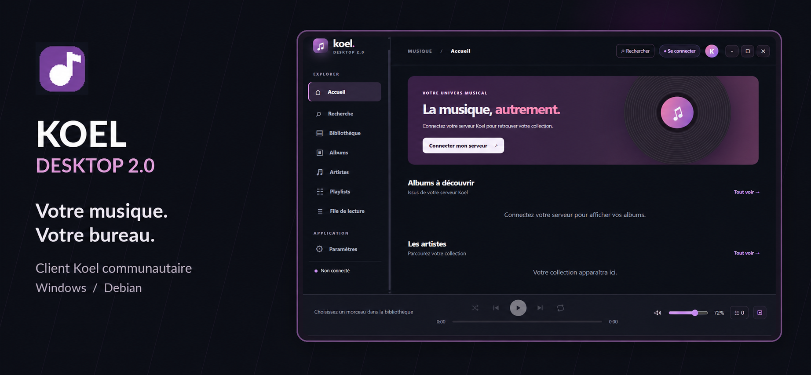
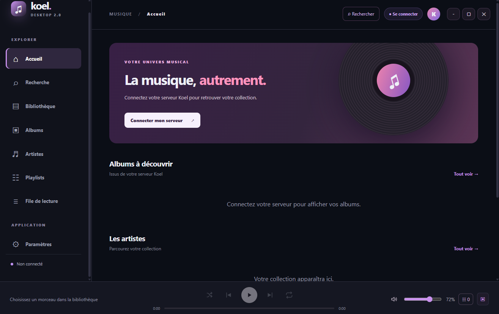
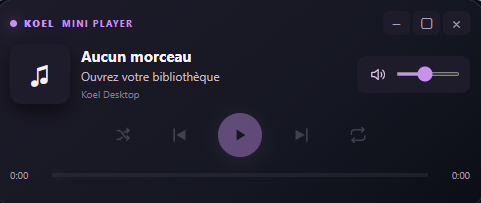

<div align="center">



<br />

[](#-t%C3%A9l%C3%A9chargement)
[](https://github.com/MakeInLab/Koel-Desktop-2.0/releases/tag/v0.7.6)
[](https://github.com/MakeInLab/Koel-Desktop-2.0/releases/tag/v0.7.6)
[](LICENSE)

**Une nouvelle façon de profiter de votre bibliothèque Koel.**  
Un client musical de bureau élégant, personnalisable et indépendant, pour Windows et Debian.

[Découvrir les fonctionnalités](#-fonctionnalit%C3%A9s) · [Contribuer](CONTRIBUTING.md)

</div>

---

## 📸 Aperçu de l'interface

<div align="center">
  
  <br />
  <sub>Capture réelle d'une version sous Windows. L'apparence peut varier selon le thème.</sub>
</div>

<br />

**Un lecteur toujours accessible**

<div align="center">
  
  <br />
  <sub>Zoom sur le mini player.</sub>
</div>

## ✨ Fonctionnalités

| 🎧 Écouter | 📚 Explorer | 🎨 Personnaliser |
| :--- | :--- | :--- |
| Lecture continue, file d'attente et commandes multimédias | Albums, artistes, recherche et bibliothèque | Ambiances sombres, couleurs d'accent et densité d'affichage |
| Mini-player flottant et déplaçable | Créer des playlists, ajouter ou retirer des titres | Préférences conservées au redémarrage |

**Également inclus :**

- Connexion à votre serveur **Koel** avec prise en charge du streaming de **Koel 9.15.0 Plus**.
- Ajout rapide du morceau en cours à une playlist et actualisation à l'ouverture des playlists.
- **Discord Rich Presence** facultatif, avec activité « Écoute ».
- Fenêtre redimensionnable, état maximisé mémorisé et barres de défilement sombres.
- Sessions mémorisées de manière chiffrée lorsque la protection du système est disponible.
- Accélération graphique matérielle lorsque l'environnement le permet.

## ⬇️ Téléchargement

Les versions Windows et Debian sont construites à partir du même code source. Les exécutables ne sont **pas nécessairement signés numériquement**.

| Plateforme | Format | Description |
| :--- | :--- | :--- |
| Windows x64 | `.exe` Setup | Installation classique avec raccourcis |
| Windows x64 | `.exe` Portable | Exécutable auto-extractible sans installation classique |
| Debian x64 | `.deb` | Installation via `apt` |
| Linux x64 | `.tar.gz` | Archive portable |

➡️ **[Consulter les Releases GitHub](../../releases)** pour les versions publiées.

> **Prérequis :** un serveur Koel accessible et un système Windows x64 ou Linux x64. Pour construire le projet depuis les sources, utiliser Node.js **24.11+** et npm.

## 🚀 Démarrage rapide

```bash
git clone https://github.com/MakeInLab/koel-desktop.git
cd koel-desktop
npm install
npm run typecheck
npm test
npm run dev
```

Pour la connexion, utilisez l'adresse HTTPS de votre serveur Koel (HTTP local autorisé pour `localhost`).

<details>
<summary><strong>Electron ne démarre pas sur Windows ?</strong></summary>

Si le message `Electron uninstall` apparaît :

```powershell
npm rebuild electron --foreground-scripts
npx electron --version
npm run dev
```

</details>

## 🛠️ Développement

Le client repose sur **Electron**, **Vue 3**, **TypeScript**, **Vite**, **Pinia** et **Vue Router**.

| Commande | Action |
| :--- | :--- |
| `npm run dev` | Lance le client en développement |
| `npm run typecheck` | Vérifie les types |
| `npm test` | Exécute les tests |
| `npm run build` | Construit l'application |
| `npm run dist:win` | Génère les éditions Windows (sur Windows, NSIS requis) |
| `npm run dist:linux` | Génère le `.deb` et l'archive Linux (sur Debian/Ubuntu) |

Pour le packaging, voir [Windows](PACKAGING-WINDOWS.md) et [Debian](DEBIAN.md). Les workflows dans `.github/workflows/` permettent aussi de construire sur GitHub Actions.

## 🤝 Participer

Les suggestions, rapports de bugs et contributions sont les bienvenus. Lire [CONTRIBUTING.md](CONTRIBUTING.md) avant une proposition de modification.

## 📖 Documentation

 [Sécurité](SECURITY.md)

## ⚖️ Licence et crédits

Ce projet est distribué sous licence **[MIT](LICENSE)**.

**Koel Desktop 2.0 est un client communautaire non officiel, indépendant du projet Koel.** Il n'est pas affilié à Koel. Koel et les autres marques citées restent la propriété de leurs détenteurs respectifs.
